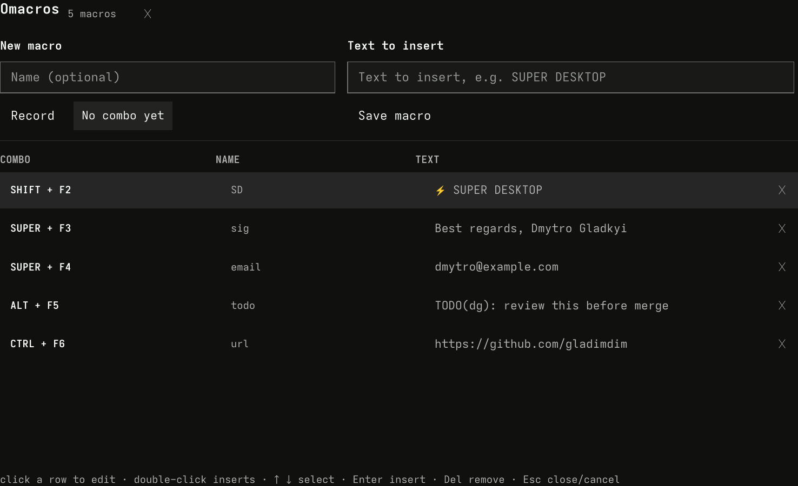

[](https://github.com/tcballard/omarchy-badges)

# Omacros (`gladimdim.omacros`)

Text macros (saved phrases) for [Omarchy](https://omarchy.org/). Click the keyboard icon in the bar, record a key combo, type the text it should insert, save — done. Phrases fire from the bar panel, a Hyprland keybinding, or the command line, and the text is typed into whatever window is focused.



## How it works

1. **Record the combo.** Click **Record keys** in the panel, then press the combination you want — hold modifiers first, then the key (e.g. hold `SUPER`, tap `F3`). `Esc` cancels.
2. **Type the phrase.** Anything you want inserted: `SUPER DESKTOP`, an email signature, a code snippet preamble.
3. **Save.** The panel hands you a ready-made `o.bind(...)` line for Hyprland. Paste it into `~/.config/hypr/bindings.lua`, save, and the combo starts inserting your text everywhere.

One line per macro, exactly as the panel shows it:

```lua
o.bind("SUPER + F3", "Omacros: Greet", "omarchy-shell gladimdim.omacros fire <id>")
```

The binding calls the plugin's IPC handler in the running shell, which types the phrase with `wtype` (Wayland virtual keyboard). No process spawning per keypress beyond one small `wtype` run.

Phrases without a keybinding still work: left-click a row in the panel to insert it now, or run `omacros paste <id>`.

## The panel

- Left-click the 󰌌 icon in the bar (center section by default): create, run or delete macros.
- Right-click a row's ␡ to delete; click a row to insert its phrase right away (the panel closes and the text is typed a moment later).
- Tooltips on the bar icon summarize your saved combos.

## Command line

```bash
omacros list              # every saved macro: id, keys, phrase
omacros keys <id>         # the recorded combo
omacros paste <id>        # insert now (types with wtype)
omacros bind <id>         # print the o.bind line for ~/.config/hypr/bindings.lua
omacros path              # state file path
```

If `omacros` is not on `PATH`, call it from the plugin directory: `~/.config/omarchy/plugins/gladimdim.omacros/scripts/omacros`.

## Install

```bash
omarchy plugin add https://github.com/gladimdim/omacros.git --enable --yes
```

Move the icon to taste:

```bash
omarchy bar move gladimdim.omacros --section center --after omarchy.clock
```

## Remove

```bash
omarchy plugin remove gladimdim.omacros --yes
```

State lives at `~/.local/state/omarchy/omacros.json` (plain JSON — up to 50 macros, 512 characters each). Delete the file to reset.

## Notes & limits

- **wtype required** (installed by default on Omarchy). If typing silently fails, check `wtype` runs in your session.
- Keybind wiring is the one manual step: Omarchy's shell can register global shortcuts it ships at startup, but arbitrary user combos must go through your `bindings.lua` — the plugin generates the exact line, the paste is yours.
- Recorded keys cover letters, digits, `F1`-`F12`, punctuation and navigation keys, with `SUPER`/`CTRL`/`ALT`/`SHIFT` modifiers. Combos already claimed by another binding will conflict — Hyprland keeps them; use a different combo.
- Phrases are single-line; `wtype` types them character by character, so a fired macro never corrupts your clipboard.

## Files

| Path                | Role                                                     |
|---------------------|----------------------------------------------------------|
| `manifest.json`     | Plugin manifest (service + bar widget, keepLoaded)       |
| `Service.qml`       | State, IPC (`fire <id>`), `wtype` typing, notifications   |
| `BarWidget.qml`     | Bar icon + macro count badge                              |
| `ListPanel.qml`     | The panel: create form with combo recorder + saved list   |
| `Omacros.js`        | Shared state/sanitize/bind-line logic (and test target)   |
| `scripts/omacros`   | CLI (`list`, `keys`, `paste`, `bind`, `path`)              |
| `tests/`            | `node tests/test-omacros.js`                              |

## Development

```bash
node tests/test-omacros.js
omakit verify . --json
omakit submit . --category Productivity --tags macros,text,typing --json --offline
```
